# Spring2026_Final_Practicum_V21.grafcet — GRAFCET as Mermaid

Mermaid diagrams of all 11 charts in `Spring2026_Final_Practicum_V21.grafcet`, one section per chart. GitHub, VS Code's Markdown preview and Obsidian all render them.

**Checks:** all 11 diagrams render without errors in Mermaid's own command-line tool. In every chart, the number of arrows equals the number of transitions, so each transition is drawn exactly once. The Main chart was compared against the file by hand and it matches.

## How the charts are split

| Chart | Enclosed by | Steps |
|---|---|---|
| Main | (top level) | 6 |
| Automatic, Automatic-Resets | step 5 (Auto) | 13, 6 |
| Manual-Speeds, Manual-PushPullls, Manual-Counters | step 4 (Manual) | 3, 33, 2 |
| Sort Raw / Sort Base / Sort Lid / Reject | steps 24 / 27 / 28 / 25 | 4, 4, 4, 3 |
| Continuous | (not enclosed) | 7 initial steps, no transitions |

## Reading the diagrams

- **Arrows:** solid arrows are transitions, labelled with their condition. Dashed arrows are jumps, drawn straight to the step they jump to.
- **Boxes:** a double-bordered box is an initial step, and a dashed box is an enclosing step that lists the charts it contains. `*` marks a step that becomes active when its enclosing step activates.
- **Actions in each step:**
  - `N` runs continuously.
  - `C … if` runs only while its condition is true.
  - `↑` runs once when the step activates.
  - `⚡` is an event action, with its trigger shown in brackets when the file gives one. Where the file's trigger is just `1`, it wasn't confirmed exactly when Grafcet-Studio fires it.

## Main

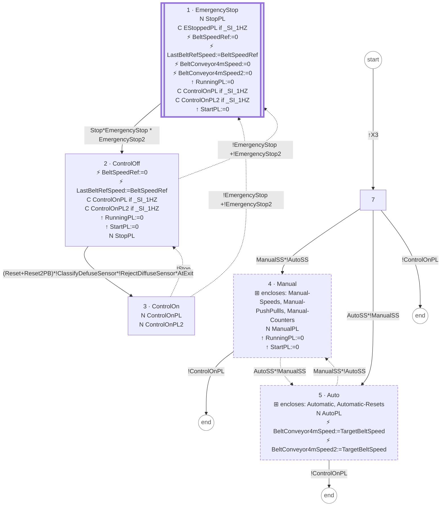

## Automatic (enclosed by step 5)

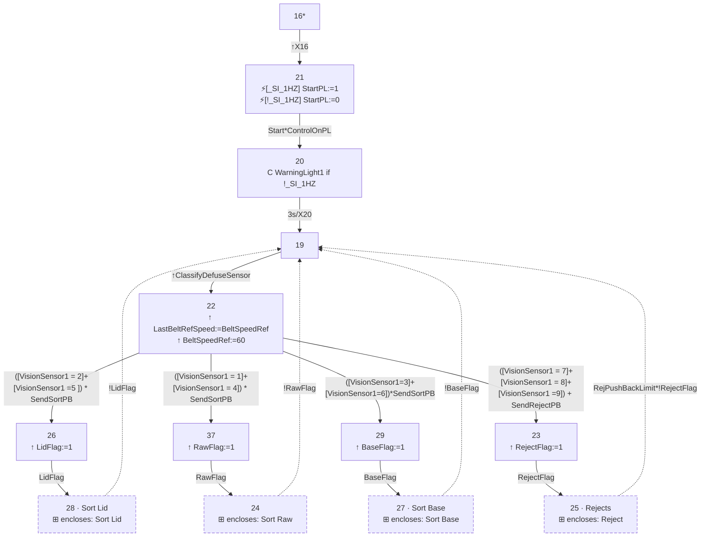

## Automatic-Resets (enclosed by step 5)

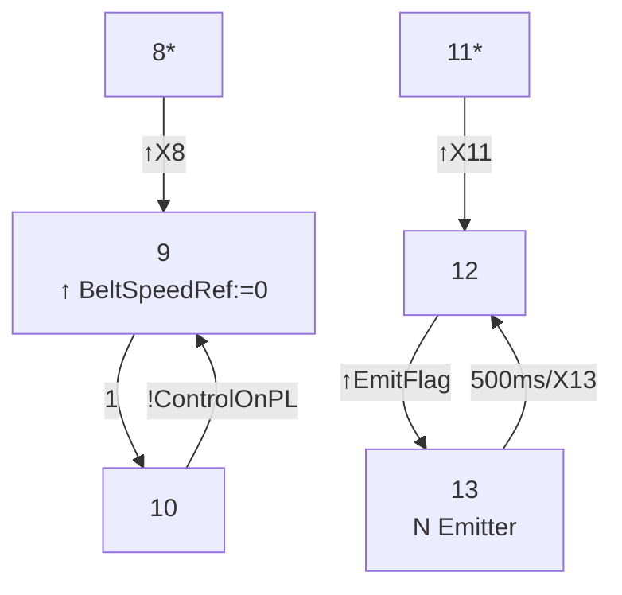

## Manual-Speeds (enclosed by step 4)

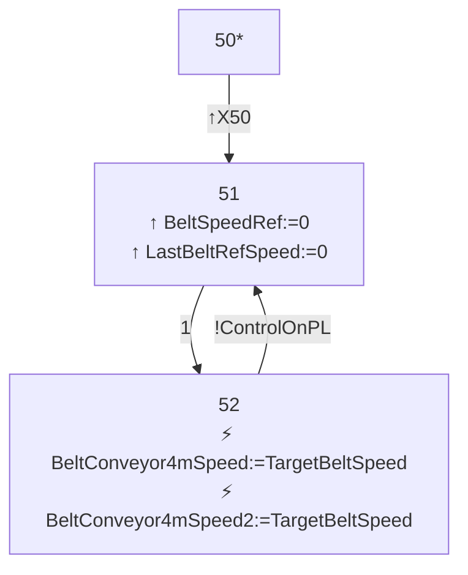

## Manual-PushPullls (enclosed by step 4)

```mermaid
flowchart TD
  S100["100*"]
  S102["102<br/>N RawSorterBeltCCWPL<br/>N RawSorterBeltCCW"]
  S103["103*"]
  S105["105<br/>N RawSorterBeltCWPL<br/>N RawSorterBeltCW"]
  S106["106*"]
  S108["108<br/>N RawSorterBeltTurnPL<br/>N RawSorterBeltTurn"]
  S109["109*"]
  S111["111<br/>N LidSorterBeltCCWPL<br/>N LidSorterBeltCCW"]
  S112["112*"]
  S114["114<br/>N LidSorterBeltCWPL<br/>N LidSorterBeltCW"]
  S115["115*"]
  S117["117<br/>N LidSorterBeltTurnPL<br/>N LidSorterBeltTurn"]
  S63["63*"]
  S65["65<br/>N BaseSorterBeltCCWPL<br/>N BaseSorterBeltCCW"]
  S66["66*"]
  S68["68<br/>N BaseSorterBeltCWPL<br/>N BaseSorterBeltCW"]
  S69["69*"]
  S71["71<br/>N BaseSorterBeltTurnPL<br/>N BaseSorterBeltTurn"]
  S90["90*"]
  S92["92<br/>N RejectPusherPL<br/>N RejectPusher"]
  S60["60*"]
  S62["62<br/>↑ BeltConveyor4mPL:=1<br/>↑ BeltSpeedRef:=60"]
  S101["101"]
  S104["104"]
  S107["107"]
  S110["110"]
  S113["113"]
  S116["116"]
  S64["64"]
  S67["67"]
  S70["70"]
  S91["91"]
  S61["61<br/>↑ BeltSpeedRef:=0<br/>↑ BeltConveyor4mPL:=0"]
  S102 -->|"↑RawSorterBeltCCWManPB"| S101
  S101 -->|"↑RawSorterBeltCCWManPB*!RawSorterBeltCW"| S102
  S105 -->|"↑RawSorterBeltCWManPB"| S104
  S104 -->|"↑RawSorterBeltCWManPB*!RawSorterBeltCCW"| S105
  S108 -->|"↑RawSorterBeltTurnManPB"| S107
  S107 -->|"↑RawSorterBeltTurnManPB"| S108
  S111 -->|"↑LidSorterBeltCCWManPB"| S110
  S110 -->|"↑LidSorterBeltCCWManPB*!LidSorterBeltCW"| S111
  S114 -->|"↑LidSorterBeltCWManPB"| S113
  S113 -->|"↑LidSorterBeltCWManPB*!LidSorterBeltCCW"| S114
  S117 -->|"↑LidSorterBeltTurnManPB"| S116
  S116 -->|"↑LidSorterBeltTurnManPB"| S117
  S65 -->|"↑BaseSorterBeltCCWManPB"| S64
  S64 -->|"↑BaseSorterBeltCCWManPB*!BaseSorterBeltCW"| S65
  S68 -->|"↑BaseSorterBeltCWManPB"| S67
  S67 -->|"↑BaseSorterBeltCWManPB*!BaseSorterBeltCCW"| S68
  S71 -->|"↑BaseSorterBeltTurnManPB"| S70
  S70 -->|"↑BaseSorterBeltTurnManPB"| S71
  S92 -->|"↑RejectPusherManPB"| S91
  S91 -->|"↑RejectPusherManPB"| S92
  S62 -->|"↑BeltConveyor4mManPB"| S61
  S61 -->|"↑BeltConveyor4mManPB"| S62
  S100 -->|"↑x100"| S101
  S103 -->|"↑X103"| S104
  S106 -->|"↑X106"| S107
  S109 -->|"↑X109"| S110
  S112 -->|"↑X112"| S113
  S115 -->|"↑X115"| S116
  S63 -->|"↑X63"| S64
  S66 -->|"↑X66"| S67
  S69 -->|"↑X69"| S70
  S90 -->|"↑X90"| S91
  S60 -->|"↑X60"| S61
  classDef initial stroke-width:4px
  classDef enclosing stroke-dasharray:6 3
  classDef trans fill:#333,color:#fff,stroke:#333
  classDef term fill:#fff,stroke:#888,color:#555
```

## Manual-Counters (enclosed by step 4)

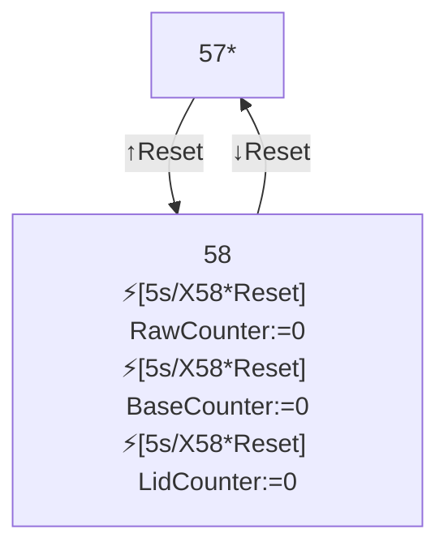

## Sort Raw (enclosed by step 24)

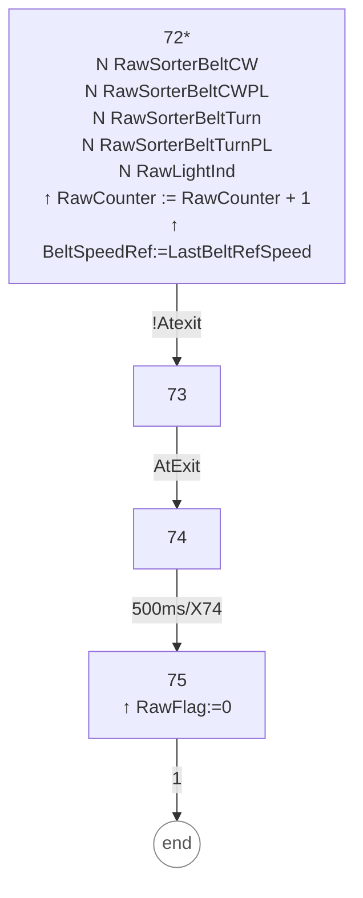

## Sort Base (enclosed by step 27)

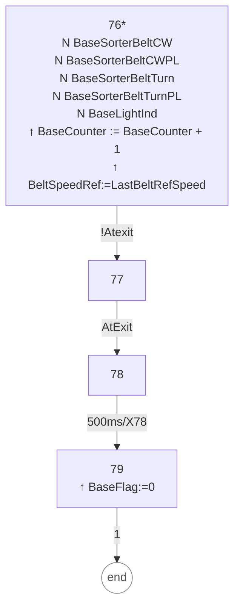

## Sort Lid (enclosed by step 28)

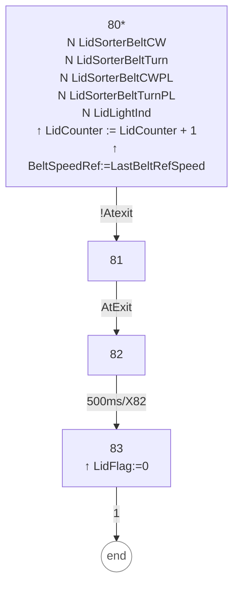

## Continuous

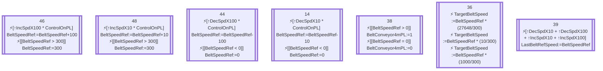

## Reject (enclosed by step 25)

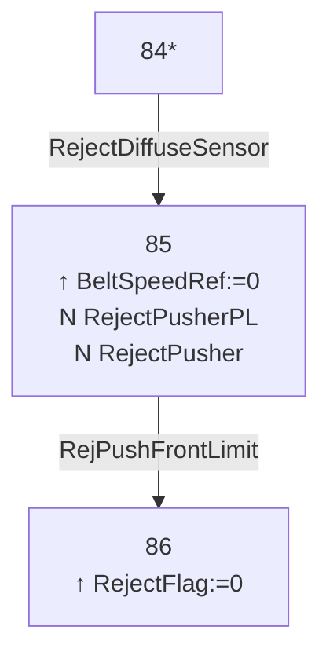
