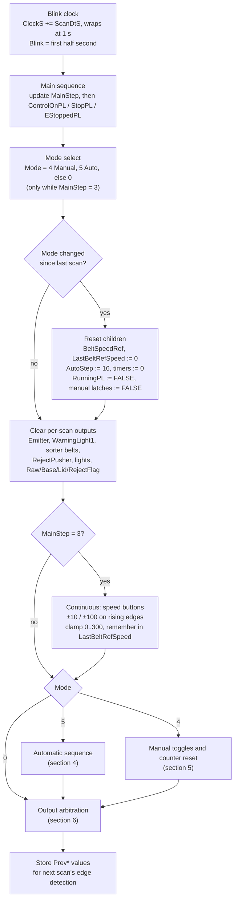
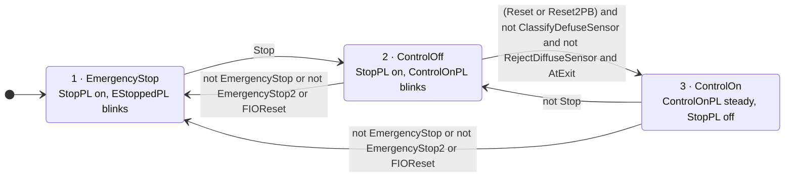
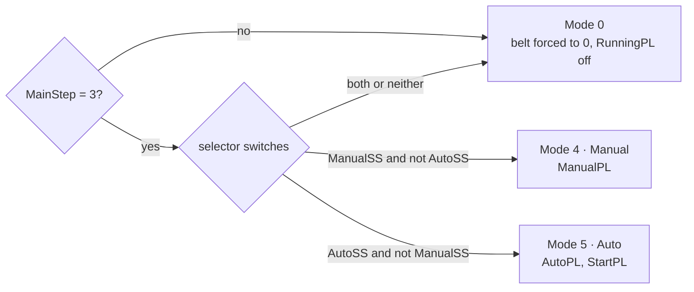
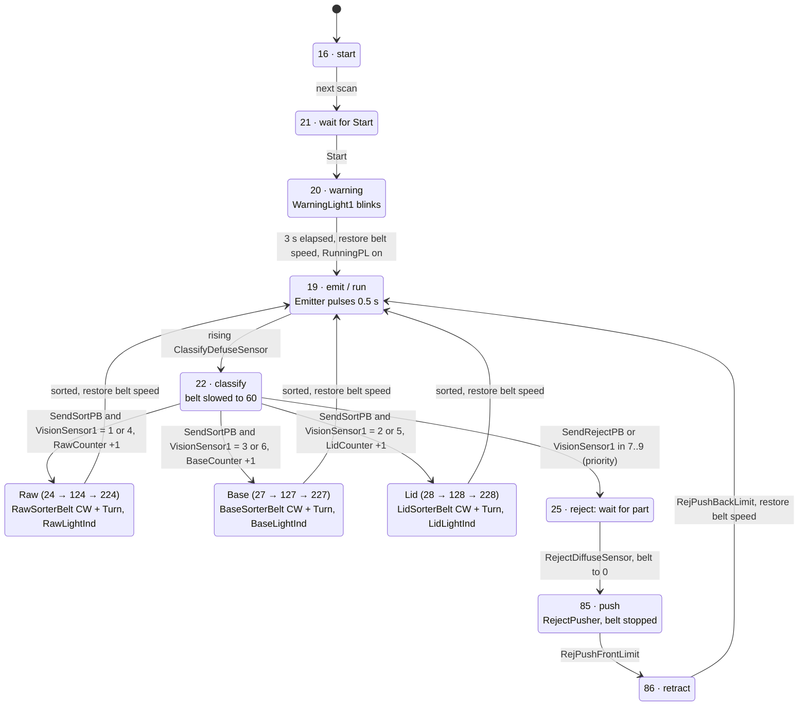
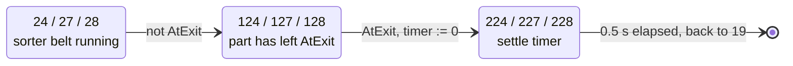
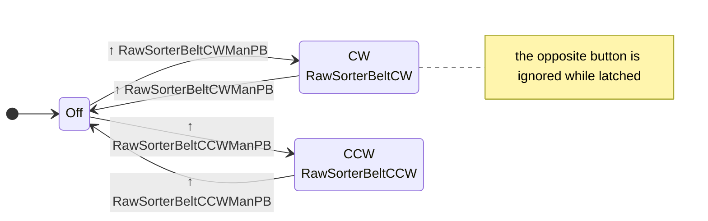
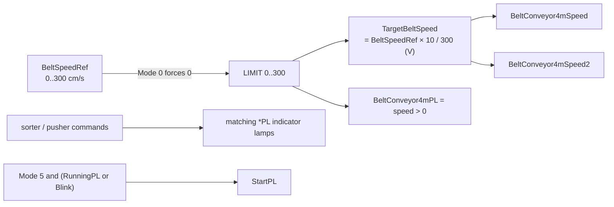

# control.st — logic as Mermaid

`control.st` is the reference translation of the GRAFCET charts (see
`Spring2026_Final_Practicum_V21.grafcet.md`). It is not scheduled directly:
`main.st` runs every 20 ms and dispatches to `lib/practicum_{st,ld,fbd}`,
which `tools/build_languages.py` generates from this file. The diagrams below
describe the logic all three share.

The chart's steps are held in three integers rather than step flags:
`MainStep` (X1/X2/X3, init 1), `Mode` (0 = none, 4 = Manual, 5 = Auto) and
`AutoStep` (the Automatic chart's step number, init 16).

## 1. One scan, in order

## 2. Main sequence (`MainStep`)

`Stop`, `EmergencyStop` and `EmergencyStop2` are normally closed: TRUE means healthy.
The rules are checked in this priority order every scan.

## 3. Mode select (`Mode`)

Any change of `Mode` restarts the child sequences (section 1, “Reset children”);
the production counters are kept.

## 4. Automatic sequence (`AutoStep`, Mode 5 only)

The sorting steps are split into three phases by adding 100: 24 → 124 → 224
for Raw, and likewise 27/127/227 for Base and 28/128/228 for Lid.

Each sorting branch steps through the same three phases:

## 5. Manual (Mode 4 only)

Every manual push button is a rising-edge toggle. Each sorter's CW and CCW
latches lock each other out. The pattern below is the Raw sorter; Base and Lid
are identical, and `RejectPusherManPB` / `BeltConveyor4mManPB` are plain toggles
(the belt toggles between speed 60 and 0).

Holding `Reset` for 5 s in Manual clears `RawCounter`, `BaseCounter` and `LidCounter`.
Leaving Manual clears all latches (section 1).

## 6. Output arbitration (every scan)

Fixed scene outputs: `Remover1..3` on; `LabPLCRunning` and `SkidPLCRunning` blink;
the panel-active and speed-button lights mirror their inputs; `StopBlade`, `Spare`
and `ProductionRate` are held at 0.
